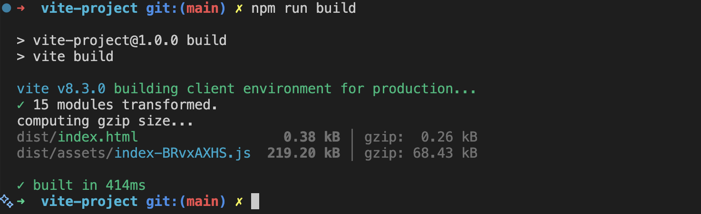

# Laboratorio Módulo 3 - Bundling

Desde el archivo _package.json_ comprobamos la versión de _vite_ que hemos instalado. Y los scrips básicos de desarrollo local:

```
"scripts": {
    "start": "vite dev",
    "build": "vite build",
    "preview": "vite preview"
  },
```

En las dependencias de desarrollo comprobamos la configuración de Typescript ("typescript": "^7.0.2") y el plugin que detecta y muestra los errores en la terminal ("vite-plugin-checker": "^0.14.5").

Las dependencias también nos indican que se ha instalado _react_

```
"devDependencies": {
    "@types/react": "^19.3.0",
    "@types/react-dom": "^19.3.0",
    "@vitejs/plugin-react": "^6.1.1",
    "typescript": "^7.0.2",
    "vite": "^8.3.0",
    "vite-plugin-checker": "^0.14.5"
  },
  "dependencies": {
    "react": "^19.3.0",
    "react-dom": "^19.3.0"
  }
```

Podemos comprobar el tamaño del bundle mediante el comando _npm run build_. El resultado se muestra en la terminal.



Para crear variables de entorno:

- Contamos con un archivo _.env_, que en este caso se encuentra visible para poder comprobar su funcionamiento.
- En el archivo _config.ts_ que se encuentra en la carpeta _src_ definimos el valor de nuestras variables de entorno para poder usarlas de una manera más fácil.
- En el archivo _hello.tsx_ mostramos el contenido tanto en la pantalla como en la consola. Este componente es exportado a _index.tsx_ para ser mostrado por medio de react.

Esta información se muestra en el entorno de desarrollo (_npm start_).

- Creamos un archivo _.env.production_ con los valores que queremos para nuestro entorno de producción. Al igual que con el _.env_ lo dejamos visible (en caso de un proyecto real estos archivos deberían estar en la carpeta _.gitignore_)

Ahora si hacemos un _npm run build_ y _npm run preview_ accedemos a la vista de esta nueva variable de entorno.
